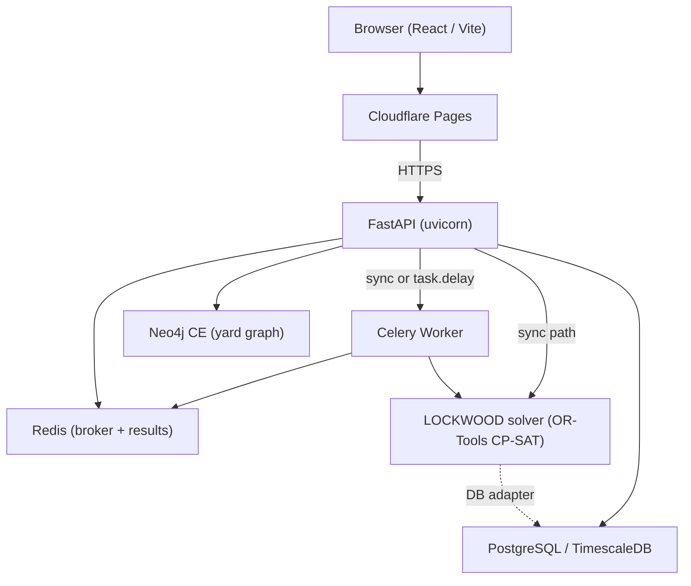

# MetGo

Overnight fleet induction planning system for Kochi Metro Rail Limited (KMRL).

---

## Problem it Solves

KMRL operates 25 trainsets on a single line. Every night, an operations team must decide which trains run the next day, which go to maintenance, which need cleaning, and which remain on standby — while satisfying regulatory constraints (fitness certificates), maintenance rules (job card severity), yard capacity limits, and a minimum service floor. MetGo automates this decision using a constraint solver and surfaces the result through a dashboard. The system recommends; the operator decides.

---

## Features

| Feature | Implementing file(s) |
|---|---|
| CP-SAT constraint solver assigns all 25 trains to one of five states (service, standby, maintenance, cleaning, breakdown) | `LOCKWOOD/src/solver/model_builder.py` |
| Soft constraint scoring (cleaning urgency, major job cards, branding contract hours, yard position) | `LOCKWOOD/src/solver/soft_constraints.py` |
| What-if scenario re-solve: force a train into any valid state, re-run the solver on the remaining fleet | `kmrl-backend/app/routers/plan.py` |
| Explainability engine: plain-English justification for every assignment | `kmrl-backend/app/services/explainability.py` |
| Natural-language query support against the solver's decision breakdown | `LOCKWOOD/src/solver/nl_query.py` |
| Muttom Yard graph model in Neo4j (bay adjacency, shunt path calculation) | `kmrl-backend/app/services/yard_graph.py` |
| Asynchronous plan generation via Celery (Redis broker) with synchronous in-process fallback for Render | `kmrl-backend/app/worker/tasks.py` |
| Fleet and station data from KMRL GTFS open data (25 stations, Blue Line) | `kmrl-backend/app/seed/seed_stations.py` |
| Automatic database seeding on first startup when the trains table is empty | `kmrl-backend/app/main.py` (lifespan handler) |
| React dashboard: plan view, alerts, yard digital twin, what-if panel, explainability view | `kmrl-frontend/src/App.jsx` |
| Leaflet-based network map of the KMRL Blue Line | `kmrl-frontend/src/components/NetworkMap.jsx` |

[ADD SCREENSHOT HERE — dashboard plan view]

[ADD SCREENSHOT HERE — yard digital twin view]

---

## Tech Stack

| Layer | Technology |
|---|---|
| Frontend framework | React 19 |
| Frontend build | Vite 8 |
| Routing | react-router-dom 7 |
| Animation | Framer Motion 13, GSAP 3, Lenis |
| Map | react-leaflet 5 / Leaflet 1.9 |
| Styling | Tailwind CSS 4 |
| Icon set | lucide-react |
| Web API | FastAPI + Uvicorn |
| ORM / migrations | SQLAlchemy + Alembic |
| Constraint solver | Google OR-Tools CP-SAT |
| Task queue | Celery + Redis |
| Graph database | Neo4j Community Edition (optional) |
| Primary database | PostgreSQL / TimescaleDB CE |
| Data parsing | Pandas |
| Testing (backend) | pytest, pytest-asyncio |
| Testing (frontend) | Playwright |

---

## Architecture Overview

MetGo is a monorepo with three independently deployable units:

1. **LOCKWOOD** — the constraint solver module (Python, OR-Tools CP-SAT). Has no dependency on the web layer; can be run standalone via `LOCKWOOD/src/run_plan.py`.
2. **kmrl-backend** — FastAPI web API. Calls the Lockwood solver either synchronously (Render/standalone) or via a Celery task queue (Docker/distributed). Persists plans and fleet data in PostgreSQL. Models yard topology in Neo4j.
3. **kmrl-frontend** — React + Vite single-page application. Communicates with the backend over HTTP. Deployed to Cloudflare Pages.



The backend supports two execution modes controlled by `DEPLOYMENT_MODE`:

- `render` / `sync` / `standalone` — solver runs in-process; no Redis or Celery required.
- `docker` (default) — plan generation is dispatched to a Celery worker via Redis.

---

## Prerequisites

- Python 3.11 (used in `Dockerfile`; 3.10+ also works locally)
- Node.js 20 (used in the frontend GitHub Actions workflow)
- **Full local setup:** PostgreSQL (TimescaleDB CE recommended), Redis, Neo4j Community Edition
- **Minimal local setup (SQLite + synchronous solver):** none of the above — set `DATABASE_URL=sqlite:///./kmrl.db` and `DEPLOYMENT_MODE=sync` in `.env`

---

## Setup and Installation

### Minimal local setup (SQLite, no Docker required)

```bash
cd kmrl-backend

python -m venv venv
# Windows:
venv\Scripts\activate
# macOS / Linux:
source venv/bin/activate

pip install -r requirements.txt

# The default .env already uses SQLite and synchronous mode.
# The server will auto-seed the database on first start.
uvicorn app.main:app --reload --port 8000
```

### Frontend

```bash
cd kmrl-frontend
npm install
npm run dev
# Dev server starts at http://localhost:5173
```

### Full Docker Compose setup (PostgreSQL + Redis + Neo4j + Celery)

```bash
# From the repo root:
docker compose up --build
```

Services started:
- `metgo_backend` on port 8000
- `metgo_celery` (Celery worker, `--pool=solo`)
- `kmrl_postgres` (TimescaleDB) on host port 5433
- `metgo-redis` on port 6379
- `kmrl_neo4j` on ports 7474 (HTTP) and 7687 (Bolt)

### Running database migrations (PostgreSQL only)

```bash
cd kmrl-backend
alembic upgrade head
```

SQLite users skip this step — `Base.metadata.create_all` runs automatically on startup.

---

## Environment Variables

Copy `kmrl-backend/.env.example` to `kmrl-backend/.env`.

| Variable | Description | Required |
|---|---|---|
| `DATABASE_URL` | SQLAlchemy connection string. Accepts `sqlite:///./kmrl.db` for local dev or a `postgresql://...` URL. | Yes |
| `DEPLOYMENT_MODE` | `render` / `sync` / `standalone` for in-process solver; `docker` for Celery queue. Default: `docker`. | No |
| `REDIS_URL` | Redis connection string. Used as Celery broker if `CELERY_BROKER_URL` is not set. | Celery only |
| `CELERY_BROKER_URL` | Celery message broker URL. Defaults to `REDIS_URL`. | Celery only |
| `CELERY_RESULT_BACKEND` | Celery result store URL. Default: `redis://localhost:6379/1`. | Celery only |
| `CELERY_ALWAYS_EAGER` | If `true`, Celery tasks run synchronously in-process. Default in `.env`: `true`. | No |
| `NEO4J_URI` | Bolt URI for Neo4j. Default: `bolt://localhost:7687`. | No |
| `NEO4J_USER` | Neo4j username. Default: `neo4j`. | No |
| `NEO4J_PASSWORD` | Neo4j password. | No |
| `APP_ENV` | `development` or `production`. | No |
| `SECRET_KEY` | Application secret key. Must be changed in production. | Yes (prod) |

Frontend variable (in `kmrl-frontend/.env.example`):

| Variable | Description |
|---|---|
| `VITE_API_BASE_URL` | Backend base URL. Defaults to `https://metgo-backend.onrender.com` if not set. |

---

## How to Run

### Backend API

```bash
cd kmrl-backend
source venv/bin/activate  # or venv\Scripts\activate on Windows
uvicorn app.main:app --reload --port 8000
```

API docs at `http://localhost:8000/docs`.

### Celery Worker (only needed when `DEPLOYMENT_MODE=docker`)

```bash
cd kmrl-backend
source venv/bin/activate
celery -A app.worker.celery_app worker --loglevel=info --pool=solo
```

> On Windows, always include `--pool=solo`. The default prefork pool is not supported on Windows.

### Frontend

```bash
cd kmrl-frontend
npm run dev
# http://localhost:5173
```

### LOCKWOOD solver (standalone)

```bash
cd LOCKWOOD
python src/run_plan.py
```

---

## How to Run Tests

**Backend:**

```bash
cd kmrl-backend
source venv/bin/activate
pytest tests/
```

**LOCKWOOD solver:**

```bash
cd LOCKWOOD
pip install -r requirements.txt
pytest tests/
```

---

## API Reference

| Method | Endpoint | Description |
|---|---|---|
| `GET` | `/` | Root response with service name and status. |
| `GET` | `/health` | Liveness probe. Always returns `{"status": "ok"}`. |
| `POST` | `/plan/generate` | Run the solver and generate tonight's induction plan for all 25 trains. |
| `POST` | `/plan/what-if` | Re-run the solver with one train forced into a specific state. Body: `{"override": {"train_id": "T09", "status": "breakdown"}}`. |
| `GET` | `/plan/{plan_id}/explain/{train_id}` | Plain-English explanation of why a train received its assignment. |
| `GET` | `/trains/` | List all 25 trains with summary data. |
| `GET` | `/trains/{train_id}` | Full detail for one train (job cards, fitness certs, branding contracts). |
| `GET` | `/stations/` | List all 25 KMRL Blue Line stations (from GTFS open data). |
| `GET` | `/tasks/{task_id}` | Poll the status of an async Celery task. |

Valid values for the what-if `status` field are defined in `LOCKWOOD/src/solver/overrides.py` (`VALID_OVERRIDE_TYPES`).

---

## Project Structure

```
MetGo/
├── Dockerfile                  # Single Dockerfile for backend + LOCKWOOD
├── docker-compose.yml          # Full local stack: Postgres, Redis, Neo4j, backend, Celery worker
├── render.yaml                 # Render.com deployment config (free tier, Docker runtime)
├── .github/
│   └── workflows/
│       ├── deploy-backend.yml  # Deploys backend to Oracle Cloud VM via SSH on push to main
│       └── deploy-frontend.yml # Builds and deploys frontend to Cloudflare Pages on push to main
│
├── kmrl-backend/               # FastAPI web API
│   ├── app/
│   │   ├── main.py             # App instance, lifespan, CORS, router registration, auto-seed
│   │   ├── config.py           # Settings from environment via pydantic-settings
│   │   ├── routers/            # plan.py, trains.py, stations.py, tasks.py
│   │   ├── models/             # SQLAlchemy models: train, plan, yard, station, timeseries
│   │   ├── services/
│   │   │   ├── explainability.py  # Translates solver output to plain English
│   │   │   └── yard_graph.py      # Neo4j queries for bay adjacency and shunt paths
│   │   ├── worker/
│   │   │   ├── celery_app.py   # Celery app instance and configuration
│   │   │   └── tasks.py        # generate_plan_async, generate_what_if_plan, call_solver
│   │   ├── seed/               # Database seeding: fleet, yard layout, stations from GTFS
│   │   └── db/                 # SQLAlchemy session, Neo4j session, hypertable setup
│   ├── alembic/                # Database migration scripts
│   ├── tests/
│   │   └── test_api.py         # Integration tests: health, trains, stations, plan, what-if, explain
│   ├── stops.txt               # GTFS stops file (source: KMRL open data)
│   ├── requirements.txt
│   └── .env.example
│
├── kmrl-frontend/              # React + Vite single-page application
│   ├── src/
│   │   ├── main.jsx            # React entry point, router, Lenis smooth scroll
│   │   ├── App.jsx             # All dashboard views: Plan, Alerts, Yard, What-If, Explain
│   │   ├── App.css             # Component styles and design system
│   │   ├── LandingPage.jsx     # Landing page
│   │   ├── api.js              # Fetch-based API client
│   │   ├── version.js          # Build timestamp and production backend URL
│   │   └── components/
│   │       ├── NetworkMap.jsx  # Leaflet map of the KMRL Blue Line
│   │       ├── PAToast.jsx     # Toast notification component
│   │       ├── SignalLight.jsx # Constraint-type signal indicator
│   │       └── TrainLoader.jsx # Loading animation
│   ├── package.json
│   └── .env.example
│
└── LOCKWOOD/                   # Standalone constraint solver module
    ├── src/
    │   ├── constants.py        # MIN_SERVICE_TRAINS=15, MAX_TRAINS_IN_MAINTENANCE=3, etc.
    │   ├── models.py           # Solver-internal data classes
    │   ├── run_plan.py         # CLI entry point
    │   ├── smoke_test.py       # Quick solver smoke test
    │   ├── adapters/           # db_adapter.py: ORM objects to solver data classes
    │   └── solver/
    │       ├── model_builder.py      # CP-SAT model: decision variables and 6 hard constraints
    │       ├── soft_constraints.py   # Soft constraint penalties for the objective
    │       ├── objective.py          # Assembles the optimization objective
    │       ├── overrides.py          # Override validation and application
    │       ├── decision_breakdown.py # Per-train constraint reasoning (for explainability)
    │       ├── nl_query.py           # Natural-language query answering
    │       ├── plan_formatter.py     # Formats solver output for the API
    │       ├── validation.py         # Post-solve plan validation
    │       ├── states.py             # String constants for the five assignment states
    │       └── soft_constraint_config.py  # Soft constraint weight configuration
    ├── tests/
    ├── requirements.txt
    └── WEIGHT_TUNING_NOTES.md  # Constraint assumptions, simplifications, and known gaps
```

---

## Deployment

### Render.com (`render.yaml`)

- Deploys the backend as a Docker web service (free tier, Oregon region).
- Provisions a managed PostgreSQL database (`metgo-postgres`, free tier).
- `DATABASE_URL` is injected automatically. `SECRET_KEY` is auto-generated.
- `NEO4J_URI` and `NEO4J_PASSWORD` must be set manually in the Render dashboard.
- Runs in `DEPLOYMENT_MODE=render` (synchronous in-process solver, no Celery).

### Cloudflare Pages (`deploy-frontend.yml`)

- Triggered on push to `main` that changes files under `kmrl-frontend/`.
- Builds with `npm run build` using `VITE_API_BASE_URL=https://metgo-backend.onrender.com`.
- Deploys `kmrl-frontend/dist/` to Cloudflare Pages (project name: `metgo`).
- Requires `CLOUDFLARE_API_TOKEN` and `CLOUDFLARE_ACCOUNT_ID` GitHub secrets.

### Oracle Cloud VM (`deploy-backend.yml`)

- Triggered on push to `main` that changes `kmrl-backend/**` or `LOCKWOOD/**`.
- SSH-deploys to a VM, pulls the repo, installs dependencies, runs `alembic upgrade head`, and restarts `metgo-api` and `metgo-celery` systemd services.
- Requires `ORACLE_VM_IP` and `ORACLE_SSH_KEY` GitHub secrets.

---

## Key Concepts

- **Induction Plan** — The overnight assignment of every train to a duty state for the next service day.
- **Lockwood Solver** — The internal OR-Tools CP-SAT constraint optimizer. Do not rename any internal functions or module paths.
- **Fitness Certificate** — A per-train regulatory compliance certificate with an expiry date. Expired trains cannot enter service (hard constraint).
- **What-If Scenario** — A simulation where an operator forces one train into a specific state (e.g., breakdown) to see how the solver adapts the rest of the fleet.
- **Breakdown state** — Only reachable via a what-if override. The solver never assigns breakdown organically; a train without an explicit breakdown override has its breakdown variable forced to 0 in the model.

---

## Challenges and Design Decisions

### 1. Two execution modes for a single codebase

The backend supports both a Celery-based distributed queue (Docker) and a synchronous in-process path (Render free tier, which has no persistent worker processes). Both paths share the same `call_solver` function in `app/worker/tasks.py`. The mode is selected by the `DEPLOYMENT_MODE` environment variable. This avoids maintaining two codebases but adds a conditional branch in both plan endpoints.

### 2. Yard capacity constraints required to prevent degenerate solutions

Before capacity hard constraints were added, the CP-SAT solver correctly but uselessly assigned all 25 trains to the cleaning state when every train appeared equally overdue — a technically feasible but operationally useless solution. The fix adds hard caps: at most 3 trains in maintenance (matching the 3 bays in the Major Repair Line, `MAX_TRAINS_IN_MAINTENANCE = 3`) and at most 2 in cleaning (`MAX_TRAINS_IN_CLEANING = 2`).

### 3. Breakdown state is only reachable via override

If no explicit breakdown override is present for a train, its breakdown variable is forced to 0 in the model. This prevents the solver from using breakdown as an escape hatch when constraints are tight. Breakdown is only injected by an operator through the what-if endpoint.

---

## Known Limitations and Future Improvements

1. **No version pinning in `requirements.txt`.** All backend dependencies are unpinned, which can cause silent breakage across major releases of OR-Tools or FastAPI.

2. **Flat service-level floor (no time-of-day planning).** The solver enforces a single floor of `MIN_SERVICE_TRAINS = 15` across the full service day. A real system would apply different floors for peak and off-peak windows. This requires per-slot decision variables — a non-trivial architecture change documented in `LOCKWOOD/WEIGHT_TUNING_NOTES.md`.

3. **`MAX_TRAINS_IN_CLEANING = 2` is an assumption.** The wash track capacity of Muttom Depot is not publicly documented. If the actual capacity differs, update `LOCKWOOD/src/constants.py`.

4. **Frontend mobile responsiveness is incomplete.** `App.css` needs a `@media (max-width: 768px)` pass to stack the sidebar and make tables scroll horizontally on mobile.

5. **Cleaning penalty investigation notes are partially lost.** The original analysis comparing flat vs. proportional cleaning penalties was overwritten and is not recoverable. See `LOCKWOOD/WEIGHT_TUNING_NOTES.md` for details.

---

## Data Attribution

Station topology and route structure are sourced from KMRL's official GTFS open data feed (`https://kochimetro.org/open-data/`). Fleet operational data (fitness certificates, job cards, cleaning slots, branding contracts) is simulated in the shape KMRL's internal systems would produce, as that layer is operationally confidential.

---

## License

MIT License — see `LICENSE` for details.
